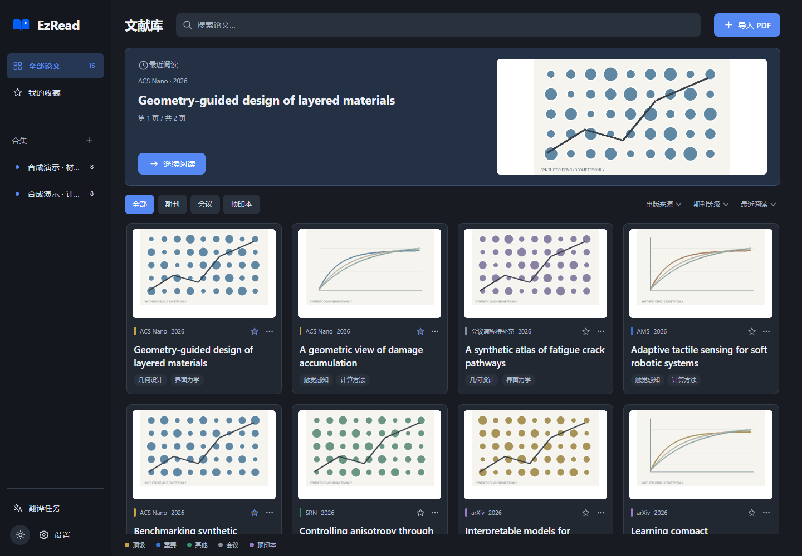

# EzRead

**独立维护的 Windows 论文阅读器，基于开源 EzRead 深度二次开发。**

本项目源自 [zhuangcao136-glitch/EzRead](https://github.com/zhuangcao136-glitch/EzRead)，由 [Laity-nun0](https://github.com/Laity-nun0/EzRead) 在其基础上持续开发。保留原项目的 MIT 版权声明与提交历史；当前仓库独立维护翻译流程、阅读界面和 Windows 安装版。改动发生在本仓库，不会自动修改原作者仓库。

## 这个版本改变了什么

| 方向 | 当前实现 |
| --- | --- |
| 全文翻译 | 从 Codex CLI 文本块翻译改为 API 驱动的 BabelDOC 原生版式流程，在本地生成单语与双语 PDF |
| 请求与恢复 | 固定每篇任务的模型、源文件、术语与协议，保存响应缓存；暂停或失败保留已有译文，新版本通过核验后才提交 |
| 阅读器 | 文献标签多开，重启恢复标签与当前篇；未译论文全宽显示原 PDF，已有译文时自动切换为原文／译文双 PDF，支持同步滚动与阅读位置保存 |
| 界面与品牌 | 重做文献库、常驻侧栏、最近阅读和卡片，单个日月按钮切换主题，采用书本与 AI 星芒的新图标 |
| Windows 交付 | 提供自带 Python 与 PDF 运行时的安装程序，支持升级、卸载保留数据和设置中的目录迁移 |

翻译和问答分别配置 API Key，日常使用无需安装或登录 Codex。当前界面开放 DeepSeek；底层保留其他协议及历史数据的兼容实现。详细来源、改造边界和保留原因见[二次开发说明](docs/DERIVATION.md)。

## 当前界面

以下截图来自实际运行的当前界面，使用完全合成的文献、配图及演示数据。阅读器中的中文 PDF 为手写模拟译文，仅展示界面，不代表真实模型翻译质量。

### 日间文献库


### 夜间文献库



### 原文与译文 PDF 对照阅读


### 期刊等级与翻译设置


## 安装与使用

在 [Releases](https://github.com/Laity-nun0/EzRead/releases/latest) 下载 `EzRead-<版本>-Setup-x64.exe`，运行安装向导。适用于 Windows 10 1809 及以上 x64 系统，使用 .NET Framework 4.8 和 WebView2。安装版自带 Python、PDF 阅读与翻译运行时；缺少 WebView2 时，首次安装需要联网下载微软运行时。

- **导入和整理**：拖入 PDF，使用收藏、手动合集、搜索与筛选整理文献。期刊颜色依据[内置名单](JOURNAL_TIERS.md)，可在设置中编辑，不代表单篇论文质量。
- **多篇阅读**：顶部标签栏切换文献，点击标签的关闭按钮只关闭该篇；点击“文献库”可继续打开其他文献。阅读时保留侧边栏与同一顶部导航，日夜切换在文献库按钮左侧，翻译任务与设置上下排成一列。重新启动会恢复关闭前的标签、当前篇与已保存的阅读状态。
- **关闭提醒**：仍有运行或排队中的翻译任务时，关闭应用会先询问。选择“否”继续使用；确认退出后暂停任务，已完成的结果保留，重开后可手动继续。
- **按需翻译**：在设置中保存翻译 API Key，再从论文的翻译入口确认任务。版面解析与排版在本地，必要原文与术语发送给所选 API；费用由供应商收取。复杂表格、公式、特殊字体和扫描件有适用限制，详见[保留版式翻译](docs/PDF_LAYOUT.md)。
- **问答与笔记**：问答使用独立配置与本篇证据，历史对话保存在本机。论文笔记与阅读位置持久保存；当前 PDF 阅读器尚无坐标批注或译文手工修订入口。
- **数据目录**：安装版初始位置为 `%LOCALAPPDATA%\EzRead\data`，源码版为项目 `data/`。3.5.3 起可在“设置 → 文献与备份 → 选择目录并迁移”中更改，核验后自动重启，原库保留。选择软件安装位置不会改变文献目录。
- **备份与升级**：在设置中导出备份，退出软件后安装新版。卸载保留文献库。备份不包含 API 密钥，换电脑后需重新填写；目录迁移则在本机完整复制私有配置。详细步骤见[安装版说明](docs/INSTALLER.md)。

`EZREAD_DATA_DIR` 可显式指定已有文献库，优先于界面保存的位置；它只切换指向，不会搬迁文件。环境变量控制目录时，界面会要求先解除覆盖再迁移。不同时启动多份软件写入同一库。

本地阅读无需密钥。模型功能的发送范围见 [API 使用说明](docs/AI_API.md#使用与发送范围)：新 PDF 导入后，配置完整时会自动校对首页与标题结构；全文翻译、问答与研究速览按界面操作发起。保存设置、启动和刷新状态不调用模型、不查询账户余额；用量只显示本次运行的供应商报告值。

## 源码与开发

```powershell
git clone https://github.com/Laity-nun0/EzRead.git
```

源码使用 Python、SQLite、原生 HTML/CSS/JavaScript 和 WebView2，无需前端构建框架。首次配置、依赖安装和桌面构建见[贡献指南](CONTRIBUTING.md)，模块关系见[架构说明](docs/ARCHITECTURE.md)。也可[下载源码 ZIP](https://github.com/Laity-nun0/EzRead/archive/refs/heads/main.zip)。

修改前保存 Git 基线并备份文献库，遵守 [AGENTS.md](AGENTS.md)。普通验证使用隔离库和模拟响应，不调用真实模型。源码版移动后需重新生成快捷方式；安装版通过安装向导升级。

## 来源、许可与反馈

感谢原项目作者与第三方组件贡献者。独立维护和大幅改造不改变原代码的版权来源。项目源码与文档沿用 [MIT License](LICENSE)；ECDICT、BabelDOC、PyMuPDF／MuPDF 等资源遵循各自许可。安装包中的 AGPL PDF 组件附带对应源码，详见[第三方声明](THIRD-PARTY-NOTICES.md)。

问题请提交至[本仓库 Issues](https://github.com/Laity-nun0/EzRead/issues)，附图前遮住私人论文、对话和账号信息。本仓库的版本号和发布节奏独立于上游，不表示已经合入上游后续功能。
