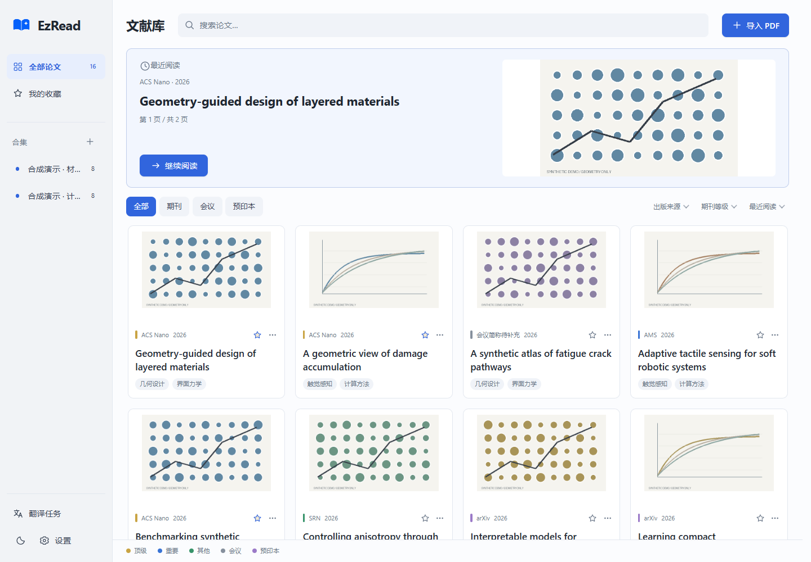
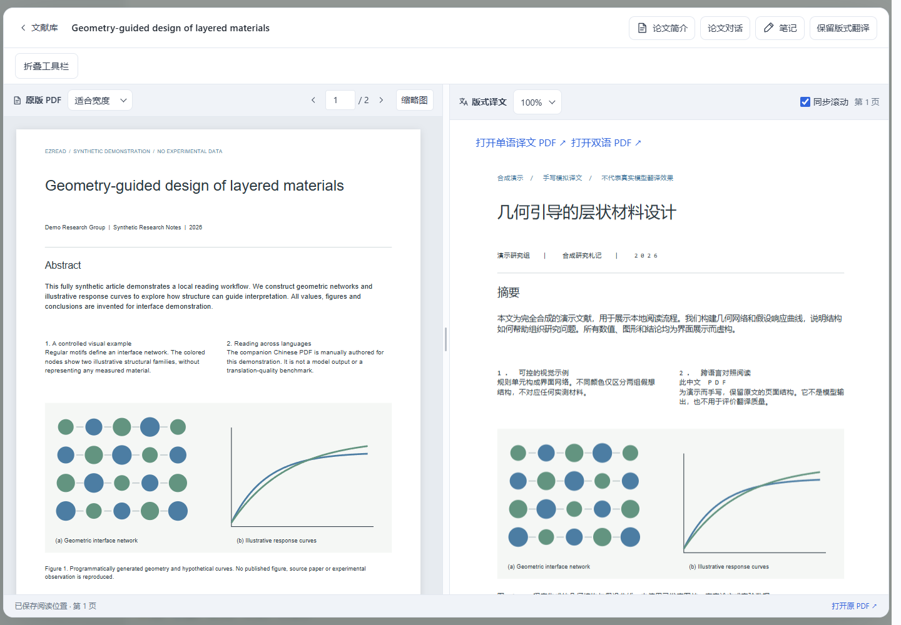
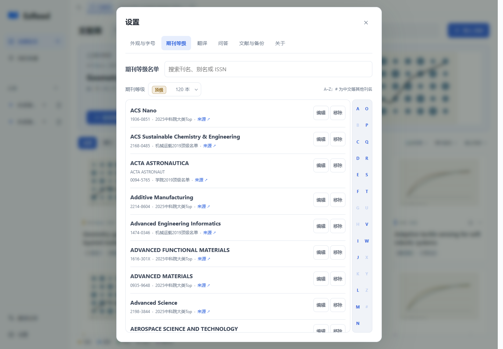
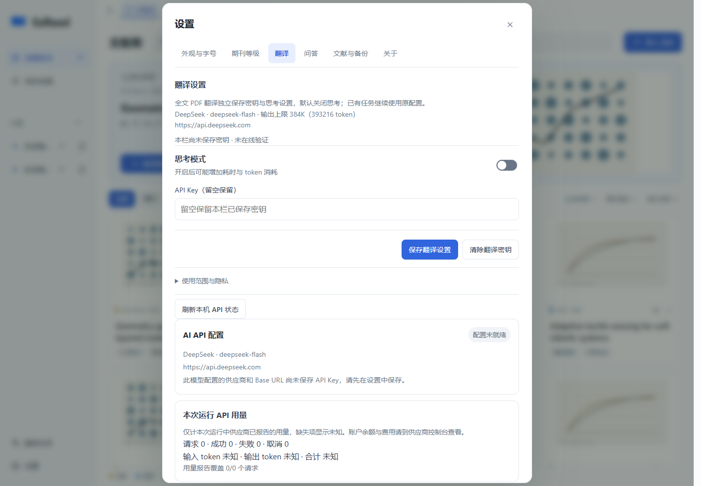

# EzRead

**一款简洁美观的 Windows 论文阅读软件。**

使用自己的 API 翻译论文、围绕论文提问、生成研究速览，并对照阅读和记录笔记；也可用 Codex 按自己的阅读习惯继续改造它。

## 五个亮点

- **简洁美观的界面**：圆润卡片、柔和配色与简洁布局，提供纸白、浅绿、石墨三种主题，把阅读体验带到 Windows 桌面。
- **DeepSeek 全文翻译与问答**：无需 Codex 登录；翻译与问答分别保存密钥和思考设置，使用官方地址及 384K 最大输出。翻译固定 Flash、默认关闭思考；问答可选 Flash / Pro、默认开启 high。连接复用但不累积整篇历史，通过本篇术语表保持译文一致。
- **满足极简的论文阅读需求**：导入 PDF、对照阅读、翻译、提问和笔记，让日常读论文的主要操作集中在一个窗口里。
- **自动识别与期刊分级**：导入文献时自动识别出版信息，依据按北京理工大学宇航学院期刊等级划分标准整理的内置名单，匹配“顶级、重要、其他”期刊类别，并通过卡片颜色区分；会议与预印本单独归类。名单依据与适用范围见[期刊等级说明](JOURNAL_TIERS.md)。
- **面向 AI Agent 的可修改架构**：按功能划分代码模块，提供协作约定、架构文档与检查入口，方便 Codex 定位代码、验证修改，用 vibe coding 增加你需要的功能。

## 界面预览

### 文献库



### 对照阅读



此截图为旧版文字阅读界面。当前阅读器仅显示 PDF：未译论文全宽显示原版 PDF，已有版式译文时自动显示原 PDF 与译文 PDF。

### 期刊等级



### 翻译设置



## 开始使用

目前采用源码运行方式，主要面向 Windows。全文翻译、论文问答、研究速览和后台结构校对使用 DeepSeek API Key，无需 Codex CLI 登录；本地阅读无需密钥。

按需求选择获取源码的方式：

- **希望跟进后续更新**：推荐使用 Git 克隆，保留版本历史，方便以后拉取作者更新。先安装 Git，再在 PowerShell 中进入希望存放软件的目录，运行：

  ```powershell
  git clone https://github.com/zhuangcao136-glitch/EzRead.git
  ```

  后续更新前先导出备份、退出 EzRead，在克隆得到的 `EzRead` 文件夹中运行 `git pull --ff-only`，再让 Codex 检查依赖并重新构建桌面组件。克隆不会自动更新；如果已经修改源码，先让 Codex 检查并保存修改，再处理更新与可能的冲突。
- **主要想自己 vibe coding，修改或新增功能**：可以直接[下载源码 ZIP](https://github.com/zhuangcao136-glitch/EzRead/archive/refs/heads/main.zip)，或在仓库首页选择 **Code → Download ZIP**，解压后交给 Codex 修改。ZIP 是一次源码快照，不包含 Git 版本历史，不能直接通过 `git pull` 获取后续更新。克隆同样支持个人定制；如果还想持续合并作者更新，建议选择克隆。

**PowerShell 网络提示**：如果当前网络访问 GitHub 需要代理，克隆和拉取更新前需为 Git 配置可用代理；浏览器能访问 GitHub 不代表 Git 已使用代理。可以让 Codex 检查并配置 Git 代理，地址和端口以本机代理软件为准；能直接连接时无需配置。

**无论通过 Git 克隆还是下载 ZIP，首次使用都需要按下面的步骤让 Codex 适配本电脑，完成依赖配置、桌面组件构建与快捷方式创建。**

1. 将源码放到希望长期存放软件的位置，例如 `D:\Apps\EzRead`；ZIP 需要先解压。打开 Codex，新建项目，选择包含 `AGENTS.md` 和 `README.md` 的源码文件夹。
2. 在该项目中新建对话，复制并发送下面这段话：

```text
请阅读当前文件夹中的 AGENTS.md 和 README.md，将 EzRead 适配到本电脑，检查并配置运行所需依赖，构建桌面组件。全文翻译、问答、速览和导入结构校对使用我在界面填写的 API，不要求 Codex 登录。完成后创建桌面快捷方式，启动软件并验证窗口能够正常打开。不要读取密钥、导入真实论文或发起真实模型请求来测试安装。
```

3. 完成必要安装后，通过桌面 **EzRead** 快捷方式打开软件，在设置的“翻译”和“问答”两栏分别保存 API Key。保存不调用模型。确认全文翻译、发送问题或生成速览时发送相应论文内容；翻译配置完成后，新导入还会自动发送首页和标题候选进行结构校对。未配置密钥仍可导入和阅读，结构保留本地规则初稿。

运行依赖包括 Python 3.10+、`requirements.txt` 中的包、.NET Framework 4.8 与 WebView2 Runtime；全文翻译另需本地 BabelDOC 组件及供应商 API Key。日常功能不需要安装或登录 Codex CLI。安装结果取决于本机环境与网络。

## 日常怎么用

- **导入与整理**：拖入 PDF，通过收藏、合集和筛选管理论文。
- **删除与重导**：删除会永久清除该篇 PDF、译文、笔记、全部对话和本机阅读草稿，无法在应用内恢复；再次导入同一 PDF 作为全新文献。旧记录仍在而资源整目录已被手动删除时，重导在本地提取成功后替换孤儿记录；仅部分资源缺失则补齐文件，保留现有记录。
- **对照阅读**：未译论文全宽显示原版 PDF；已有版式译文时自动显示左原 PDF、右译文 PDF，阅读期间后台完成翻译也会自动切换。可调整分栏、页面缩放和主题，并接着上次的位置继续读。
- **按需翻译**：全文翻译通过独立 API 计费，保留本地 BabelDOC 原生流程生成单语／双语 PDF。确认窗口可设置本篇术语；每批只发送本批原文、引擎提示词与相关术语。旧 Codex 草稿保留，须明确使用 API 重新生成；已有译文、批注和版本保留。配置、离线验证及质量边界见[保留版式翻译](docs/PDF_LAYOUT.md)。
- **围绕论文提问与速览**：问答使用独立设置，每篇论文保持一个连续对话，可在侧边栏选择 Flash / Pro 和思考强度，历史消息不清空。请求只带有界近期对话、笔记、速览和本轮论文证据。研究速览沿用翻译配置，保留内容校验，失败不覆盖已有内容。详见[API 使用说明](docs/AI_API.md)。
- **留下阅读记录**：论文笔记和阅读位置保存在本机。旧正文、译文、批注、修订历史及本机未提交草稿保留，但旧正文编辑与历史查看入口已移除，当前尚未提供 PDF 坐标批注或修订编辑。

## 让 Codex 加上你需要的功能

在同一个项目中开启对话，描述希望改变的具体操作即可。例如：

```text
请先阅读 AGENTS.md 和 docs/ARCHITECTURE.md，为文献库增加“按发表年份筛选”的功能，沿用现有界面风格。保留现有论文、译文、笔记和阅读记录，完成后检查相关功能，并告诉我如何验证和使用。
```

项目采用 Python、SQLite 与原生 HTML/CSS/JavaScript，按功能拆分前后端模块。进一步开发可参考 [架构说明](docs/ARCHITECTURE.md)、[协作约定](AGENTS.md) 和 [贡献与个人定制](CONTRIBUTING.md)。

## 使用前了解这几件事

- **API 配置与用量**：所有模型功能使用供应商 API。保存配置、启动及刷新状态不测试连接，不查询登录或账户额度。用量面板只统计本次运行的请求与供应商报告的 token，缺失项显示未知；账户余额和费用请到供应商控制台查看。连接失败保留已有结果，不自动换供应商或无限重试。
- **数据**：论文、译文、笔记等默认保存在项目的 `data/` 中。模型功能按[发送范围](docs/AI_API.md#使用与发送范围)将必要内容发送给选定 API 供应商；导入后的结构校对在配置完整时自动执行。API 密钥保存在本机私有文件，不进入文献备份，换电脑后需重新填写；本地存储不等于 AI 离线运行。
- **备份**：在设置中使用“导出备份”。更新、移动软件或更换电脑前先备份，保留数据目录；移动软件后重新运行 `setup-desktop.ps1` 更新快捷方式。
- **PDF 支持**：主要适用于文字型 PDF，目前不提供扫描件 OCR 全文翻译。复杂双栏、表格、公式及图中文字可能提取不完整，译文和回答需结合原文核对。

## 开源与反馈

欢迎通过 [GitHub Issues](https://github.com/zhuangcao136-glitch/EzRead/issues) 反馈问题或提出功能建议。描述复现步骤、预期结果和实际表现即可；附图前请遮住私人论文、对话和账号信息。

源码与项目文档采用 [MIT License](LICENSE)。内置 ECDICT 词典保留其[上游授权声明](assets/dictionaries/LICENSE-ECDICT.txt)，第三方依赖遵循各自许可证。
