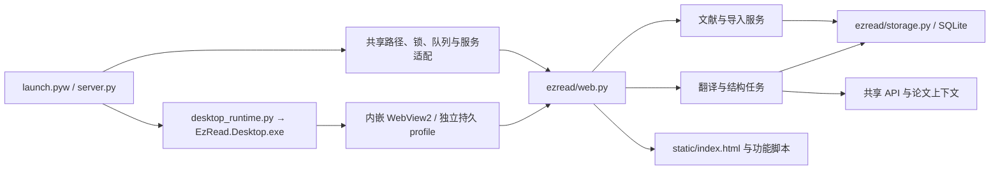

# EzRead 架构

项目采用本机 Python HTTP 服务、SQLite 和原生网页界面，Windows 启动入口使用独立 WinForms 窗口内嵌 WebView2。用户可以让自己的编程助手直接修改源码，再刷新界面或重启后台加载改动。原有 HTTP 接口、数据格式和交互保持兼容。

主窗口收到关闭请求后先保存窗口位置并立即隐藏主窗口及其已显示的子窗口，保留 WebView2 完成前端笔记、阅读位置、偏好和本机草稿保存，再通过绑定实例的 `/api/shutdown` 退出后台。保存未确认或关闭异常时恢复窗口并提示重试；关闭准备期间重复启动不会重新唤醒窗口。`ezread/lifecycle.py` 取消在途选区与任务、保留重译 staging 并持久化暂停状态，停止接收新请求。模型通道通过 `ezread/processes.py` 统一登记自己的进程；后台和原生宿主各自使用 Windows Job Object，让进程退出时内核清理剩余模型／WebView2 后代。宿主绑定后台的实例 ID 和稳定进程句柄，避免 PID 重用误关其他进程；`/api/desktop-attach` 只监视当前应用目录的真实桌面 EXE，宿主异常退出也触发后台清理。启动器等待正在退出的旧实例释放端口，下一次打开创建新后台。关闭子窗口和重复启动唤醒均不退出主窗口的后台。

关闭期间不显示 WebView2 故障弹窗，也不处理新的子窗口、下载和布局回调。错误提示通过窗口消息队列延后显示，避免在 WebView2 回调或脚本完成回调中运行阻塞式弹窗、卡住后续浏览器事件。主窗口在等待网络保存前，把已缓存的阅读草稿同步写入实际 data 目录的 `desktop-close-drafts.json`，原子替换并刷新文件到磁盘。浏览器进程此后崩溃时仍可完成退出；下一次打开相同服务地址时恢复这份草稿。恢复标识避免页面重载反复覆盖新编辑，正常保存确认后删除快照。偏好尚在保存、草稿缓存或文件写入失败时不按快照强行退出；关闭异常需要恢复窗口时先重建失效的 WebView2。日志只记录所属 PID、关闭确认、恢复和故障类别，不记录草稿正文。

主窗口隐藏和最终退出时通过 `ITaskbarList::DeleteTab` 显式移除自己的任务栏按钮，保存失败恢复窗口时通过 `AddTab` 恢复；不操作其他应用的 HWND。原生验收传入唯一 `--verification-session`，关闭任务栏显示并使用 `EzRead.Desktop.Verification.<UUID>` 身份；`--smoke-test` 也自动使用独立身份。测试的强制结束和临时窗口不得与实际软件共用任务栏组。

`scripts/verify-exit.py --executable <workspace-build>/EzRead.Desktop.exe` 在独立库中验证关闭／重开、任务草稿与笔记保留、后台及模型后代退出、后台崩溃清理、宿主崩溃后的后台和 WebView2 清理，以及关闭途中浏览器崩溃后不重新弹窗、重开恢复草稿；模型进程均为本地模拟进程。它还核对测试窗口不显示任务栏按钮、独立身份及任务栏 API 调用结果；真实 Explorer 按钮是否残留仍需现场 UI 验收。

## 入口与依赖

`launch.pyw` 在检查桌面组件、启动后台和等待原生页面就绪期间持有同一把命名互斥锁。新后台通过 `ezread/launching.py` 的启动租约监视启动器：原生窗口确认就绪后移交归属；失败或启动器异常退出时只结束本次创建的后台及其 Job 后代，兼容 Python 虚拟环境的 EXE 转发进程。复用的后台不进入该租约，原生页面导航成功后才绑定宿主退出监视。原生页面通过每次启动独立的原子报告文件确认就绪，临时报告随启动事务回收；页面刷新不重复生成报告。

重复启动通过带实例标识的原生窗口消息取得明确确认；窗口正在初始化或关闭时返回延后状态。启动器保留重开请求，等待旧实例退出后再创建窗口；保存失败恢复时则激活原窗口。消息只发给匹配当前源码、文献目录及服务地址的主窗口，并设置通信超时。

关闭阶段分别限制草稿读取（2 秒）、草稿临时文件写入（3 秒）、浏览器恢复标记（1 秒）和保存确认（8 秒）；单次浏览器调用也有独立超时。迟到的脚本结果不能继续已取消的原生关闭流程，迟到的临时文件写入不能提交为恢复快照。未确认保存时恢复窗口；后台只在前端保存确认或已有安全草稿的浏览器崩溃路径退出。后台关闭请求有 2 秒绝对超时，随后正常退出等待 7 秒，超时仅终止已持有稳定句柄的所属后台，再等待最多 3 秒。不在窗口销毁回调中重复同步等待后台。

`scripts/verify-launch.py --executable <workspace-build>/EzRead.Desktop.exe` 验证三次并发启动、关闭中的三次重开请求、启动后刷新、新后台启动失败回收、既有后台保护及启动器崩溃清理。`verify-exit.py` 另覆盖草稿读取卡住、保存确认永不返回、后台关闭接口卡住的限时恢复／退出；全部使用独立库、独立任务栏身份和模拟模型。

`server.py` 是组装入口，定义每个服务实例使用的路径、锁、任务队列和默认设置，并以兼容函数委托给 `ezread/`。这些函数也是既有测试和本地脚本的调用入口。

`ezread/context.py` 定义 `ApplicationContext`：服务需要哪些共享状态与操作。运行时由入口模块提供，调用时显式传入。业务模块不导入 `server`，所以没有循环导入；测试可以注入临时路径、模拟模型调用与独立队列。当前契约保留既有全局命名，尚未把应用转换成多实例对象。

文献删除由 `ezread/library.py` 统一执行永久删除，导入与删除共用文件锁；活跃任务或会话尚未停止时明确拒绝删除。资源及桌面草稿快照先准备临时恢复副本，文件清理与四张文献／会话表的删除失败时回滚；成功后清理副本，并用本次运行的删除标记阻止过期任务写回。前端同步清理该篇阅读草稿和会话状态。再次导入使用新身份；仅部分资源缺失时补齐文件，整目录缺失时在新提取完整后替换孤儿记录。旧回收站记录只保留兼容入口，不自动批量清理历史文献。

| 后端模块 | 职责 |
| --- | --- |
| `config.py` | 统一版本、环境变量、相对路径解析与旧变量只读兼容 |
| `storage.py` | 建库、连接、文献 CRUD、设置存储与重启后的任务状态恢复 |
| `preferences.py` | 设置和阅读状态的校验 |
| `library.py` | 对外文献数据、元数据、源文件操作 |
| `imports.py` | PDF 签名、哈希去重、提取、导入与失败清理 |
| `publication.py` | 用户确认后的出版信息检索、匹配、补空与来源追踪 |
| `structure.py` | 原文整理队列、源指纹验证与原子提交，保留既有合集归属 |
| `translations.py` | 模型快照、历史版本、草稿、重译暂存与完整提交 |
| `pdf_translations.py` | 独立版式译文任务、文字单元校验、派生 PDF 与版本/草稿提交 |
| `api_settings.py` | 独立 API 配置与绑定供应商/地址的本机私有密钥，公开读取不含密钥 |
| `translation_api.py` | 四类 HTTP 协议、连接复用、无历史请求、取消及供应商响应校验 |
| `pdf_native_translation.py` | 原生请求缓存与响应核验；v3 完整批次原样交给上游解析或恢复，v2 保留原包装兼容与原始已付费响应 |
| `pdf_native_adapter.py` | 原样调用上游解析器后检查正文与公式对象，保留原子回滚和单段恢复终态闸门，不改写解析输入或复制翻译循环 |
| `translation_validation.py` | 响应 JSON 重复字段／非标准值检查与公式、字体标记配对校验 |
| `ai_api.py` | 应用持有的问答、速览、结构、选句、段落重译和期刊预览连接池；按通道串行复用，关闭时取消 |
| `selection_api.py` | 选句与段落重译 API、当前论文术语筛选、输出校验 |
| `api_usage.py`、`ai_status.py` | 本次运行的供应商报告用量与本地配置状态，不查询账户或远端模型目录 |
| `translation_glossary.py` | 冻结本篇术语种子及原生表格边界校验；旧任务的术语筛选、证据核验与缓存顺序重放 |
| `translation_numbers.py` | 数字、单位、引文与编号的启发式差异检测；内容差异由 PDF 任务统一转为待核对 |
| `pdf_layout_quality.py` | 正文有效字号、字形碰撞及检查覆盖范围；供发布前检查和审计 CLI 共用 |
| `tasks.py` | 通用队列、取消、继续和 API 受限后的任务暂停 |
| `overview.py` | 原有速览提示词/schema、API 调用、结构校验及历史交接文本格式 |
| `web.py` | HTTP 契约、输入校验、静态资源与媒体路由 |
| `journal_catalogue.py` | 个人期刊名单热加载、排序、校验、版本冲突、原子保存、历史快照和 API 修改预览 |
| `utils.py` | 无状态工具 |

根目录的 `pdf_tools.py`、`paper_ai.py`、`journal_tiers.py` 与原生 Windows 辅助模块是独立适配器；`ezread/` 中的应用服务调用这些适配器。`codex_bridge.py`、`codex_models.py`、`codex_usage.py`、`selection_codex.py` 保留遗留适配器和开发检查，但日常模型功能不调用它们；服务关闭仅复用旧进程终止帮助函数。`paper_structure.py` 加载随源码分发的论文导入流程。完整定位表见根目录 `AGENTS.md`。

PDF 提取按区域区分图、表与正文。图注限制图像下边界，裁图包含外围编号、坐标轴和旋转标注；邻栏正文限制标签扩展，公式的分数线不能把单栏图扩成全宽图。跨栏表格在正文分栏前由表题、横线和重复单元格位置定位，正文中的 Table 引用不构成表格。表题独立为 caption，表内内容作为 is_table 图像块保存，不显示重复单元格文字、不计入全文翻译目标或模型正文；原提取文字与旧译文仍保留在数据中。温度单位等行内上标按相邻字形归回所在行；不能可靠解析的分式保留完整原段截图供核对。提取截图与原始边界框继续作为历史资源保留；当前阅读器直接渲染完整 PDF 页面，不再用截图和文字块拼接正文。

`scripts/repair-extraction.py --paper <id>` 生成旧文献补正预览；正常关闭应用后加 `--apply`，在启动互斥内在线备份 SQLite、校验资源归档并检查文献是否有并发变化，再提交。`ezread/extraction.py` 保留全部既有块 ID、初始 text、译文、修订、批注与阅读数据：新提取文字放入 extraction_text，用户 text_override 优先；归入图或合并段落的旧块以 extraction_hidden 保留。历史译文计数、兼容任务与模型输入使用同一可见块契约；PDF 页面展示直接读取原文件或已提交派生文件。带用户修订、批注或多段既有译文的范围不自动合并；新增图注保持未翻译，需由用户确认续译。新截图使用独立文件名，旧资源与版本继续保留。

全文翻译统一为 PDF 版式流程。`pdf_layout_engine.py` 在 `.deps/babeldoc/` 的隔离进程调用 BabelDOC 0.6.4 原生 LLM 管线，复用标准 OpenAITranslator 的占位符接口并通过共享 API 传输，不复制上游批次翻译循环，保留原子提交与最终失败检查。`ezread/pdf_translations.py` 负责任务、派生版本与原子发布；`pdf_native_translation.py` 按同源、同模型和完整上游提示词保存可恢复响应，`translation_api.ApiTranslationSession` 负责传输。旧 Codex 草稿可本地恢复，必须确认新建 API 任务后重新生成，旧任务与缓存归档保留。独立质量核验保留，但原生跟踪不能提供完整几何时明确标记未评估。实现与验收边界见 [保留版式翻译](PDF_LAYOUT.md)。

旧 HTML 全文生成入口、队列执行已退役，旧端点返回 410，历史任务保留为 retired。`translations.py` 继续保留旧正文快照、版本、草稿及恢复 API 的数据兼容；原文块、既有译文、批注和修订不删除。阅读器已移除旧正文显示、编辑、选区翻译及修订历史入口，`reader-text.js` 已删除。`static/reader.js`、`reader-layout.js` 与 `reader-pdf.js` 统一展示原 PDF 和已提交译文 PDF；新 PDF 不修改旧批注锚点，当前尚无 PDF 坐标批注或修订编辑。

## 目录边界

| 位置 | 保存内容 |
| --- | --- |
| 根目录入口与适配器 | 启动、桌面与外部能力连接，不保存历史实现副本 |
| `ezread/` | 按职责划分的后端应用服务 |
| `static/` | 当前界面脚本、样式、图标与内置期刊名单 |
| `desktop/` | 原生窗口源码与 manifest；`bin/` 是忽略的构建产物 |
| `assets/`、`skills/` | 公共资源、授权信息和随软件分发的论文导入流程 |
| `scripts/`、`tests/` | 可复用维护工具与离线回归 |
| `docs/` | 架构与开发说明 |
| `data/` | 私人论文库、阅读状态与浏览器 profile，不提交 |
| `work/`、`output/`、`.deps/` | 本机诊断、验证产物与依赖缓存，不提交 |

历史源码由 Git 和 `work/backups/` 保存；旧的一次性诊断与截图归档到 `work/archive/`，不作为当前可执行入口。旧环境变量、浏览器保存键、段落批注与草稿迁移属于有效兼容逻辑，集中保留在对应模块。

出版信息联网查询统一进入 `publication.py` 的用户确认流程；已移除未被业务调用的旧 `crossref_metadata` 函数及其入口适配。旧选区卡片、段落编辑器与专用样式已移除；原有段落和选区草稿保存键继续保留，桌面关闭快照仍覆盖这些数据，不自动提交、删除或转换成 PDF 批注。

## 前端

`index.html` 用经典 `defer` 脚本明确加载顺序；无需 npm 或打包。各文件定义函数，只有最后的 `app.js` 执行初始化。先加载的阅读器与弹窗在用户操作时调用公共函数，此时所有脚本已加载。

- `core/`：共享状态与常量、DOM、显示格式、偏好和 HTTP 请求。
- `core/storage.js`：统一 `ezread-*` 保存键，将旧缓存迁移到新键；写入失败保留旧值。
- `library/`：文献操作、筛选排序、卡片布局、多选、拖动和导入。
- `detail/`：论文简介、笔记保存、元数据和封面操作。
- `tasks/`：任务列表、本地 API 配置状态和本次运行用量展示。
- `reader.js`：阅读器布局、阅读位置、通用笔记和关闭保存；`reader-layout.js`：版式译文展示；`reader-pdf.js`：本地 PDF.js 页面渲染、文字层及资源回收。
- `paper-chat.js`、`translation-ui.js`、`settings-ui.js`：论文对话、翻译确认与设置。
- `app.js`：绑定事件、轮询和启动。

当前是按功能分文件的经典脚本模块，仍共享状态和公共函数。新增功能应沿用 `state`、`api()`、`patchPaper()` 等公共契约，避免复制状态。没有声称完成 ES Module 封装；若未来规模需要，可逐个迁移，而不是一次重写界面。

论文问答通过 `/api/papers/<id>/ai/chat-stream` 返回 NDJSON 状态、代际及完成事件，`core/api.js` 的 `apiStream()` 按 UTF-8 分段读取。发送时显示提问和等待计时；API 当前返回完整 JSON，只有通过引用校验后才保存并显示最终回答，不伪造推理过程或逐字输出。历史 reasoning 消息仍可查看。每篇论文显示一个连续对话，前端按论文隔离在途状态；侧栏选择 DeepSeek Flash / Pro 与思考强度，保存后从下一轮生效，不清空消息或新建对话版本。

`paper_ai` 沿用既有 SQLite 表和历史 generation 的 handoff JSON，不做表结构迁移。旧消息和线程编号保留，当前问答聚合本篇全部代际的消息；每轮读取设置中的问答配置与本篇显式覆盖，未覆盖时跟随设置。问答与翻译、速览的配置快照独立，切换问答模型不改变已排队任务。发给模型的近期问答合计最多 14 条、16000 字符，排除 reasoning，不重复拼入旧交接记录；另发送有界笔记、速览和本轮检索证据，不发送供应商配置或重复历史笔记。完整历史继续保存在本地，显式按代际读取的兼容接口保留。`paper-chat-markdown.js` 使用安全 DOM 渲染 Markdown；宽窄窗口和对话面板宽度保存沿用原行为。`/ai/open` 返回 410，界面不再提供旧版本选择和外部线程打开入口。

`journal-catalogue-ui.js` 提供设置中的期刊等级面板；HTTP 与 CLI 共用 `ezread/journal_catalogue.py`。内置 CSV 只读作为初始值，当前 data 目录的个人 CSV 保存完整名单，按内容摘要作为 revision；写入使用跨进程锁及原子替换。公开论文每次按当前有效名单计算评级，轮询签名包含等级与身份冲突标记，让文件编辑也能更新颜色和筛选。共享 API 仅生成 JSON 操作预览，验证后通过同一保存入口应用，不直接写源码或文献库。

样式按 `style`、`preferences`、`reader`、`redesign`、`surfaces` 的顺序覆盖。最后一层统一冷灰／蓝色主题、轻边界、圆角与交互反馈；不为科学插图应用主题滤镜。

文献库顶部提供搜索、导入、类型筛选与单个排序选择器，保留出版来源、期刊等级及六个排序方向。侧栏保留全部论文、收藏、手动合集、翻译任务与设置。卡片以封面、来源／年份、英文标题及最多两个标签排列，等级由小色条与底部图例标识；完整标题不裁切，次级操作集中在更多菜单，保留简介、翻译、模型、对话、多选、PDF 文件操作与确认删除。`renderRecentReading()` 仅在默认无筛选、非多选的文献库中显示最大有效 `last_read` 对应的论文；从未阅读时隐藏，页码来自已有阅读状态，不按导入时间伪造阅读记录。

阅读器仅使用 PDF 页面。未译论文全宽显示原 PDF，隐藏译文栏和分隔条；存在已提交的版式译文时自动显示左原 PDF、右单语译文 PDF。后台翻译完成后，轮询获取完整产物并自动切换，笔记编辑不阻塞该切换；有效 PDF 文字选区受到保护。旧正文视图和语言偏好不再参与渲染，保留原有草稿不会重新启用旧正文界面。

两侧使用本地 PDF.js 按栏宽、缩放与设备像素密度渲染页面，并提供原生选择和 Ctrl+C。仅为可见页面及邻页分配画布，离屏页面及时回收；有效选区内的页面暂不回收，关闭阅读器释放文档和 worker。原 PDF 缩放支持适合宽度及 40–200%，译文缩放沿用 `reader_zoom` 偏好和已有缩放参数，Ctrl+滚轮分别调整当前栏；缩放后重绘 PDF 矢量内容。

双栏始终连续滚动。左右联动以对应 PDF 页的顶部为锚点，在相邻锚点之间按滚动距离连续插值，覆盖首尾滚动边界。分栏比例、页码、页内位置、缩放和工具栏折叠状态沿用现有保存契约；旧正文块位置字段保留，不被 PDF 位置覆盖。首次显示译文且尚无 PDF 锚点时跟随原 PDF 的当前页和页内位置。收起笔记等布局调整后的待执行锚点恢复不能覆盖用户随后明确跳页。论文对话中的源块引用继续按其 PDF 页定位，原 PDF 独立窗口、论文通用笔记及关闭前保存继续可用。

主题入口为侧栏底部的单个图标按钮：日间显示月亮，夜间显示太阳，点击在 `paper`／`graphite` 间切换。复用现有浏览器缓存与串行偏好保存，下次打开恢复已选模式，设置页不再重复提供主题网格。旧 `sage` 值在前端按日间兼容，后端仍可读取旧值；不迁移或清除真实库中的历史偏好。

原生宿主观察主页面的 `data-theme`，沿用受本机地址与主页面路径限制的 WebView2 消息通道，只接受布尔类型的主题值；使用 [DWM 窗口属性](https://learn.microsoft.com/en-us/windows/win32/api/dwmapi/ne-dwmapi-dwmwindowattribute) 同步本窗口标题栏的日夜模式、背景与文字，原 PDF 子窗口继承并跟随。窗口句柄重建时重放已选主题，不修改 Windows 全局外观设置；不支持该窗口属性的系统保留系统标题栏并记录接口状态。`verify-desktop.py` 对日间→夜间→日间分别核对真实 HWND 的 DWM 状态、颜色设置结果与本窗口标题栏截图像素。

文献库以 1440 CSS 像素下的四列为尺寸基准，预留稳定滚动条占位，保持卡片宽度和间距不变，按可用宽度切换五、四、三、两列，保留最短列布局并整体居中。主桌面窗口根据当前显示器可用区域的长边及 DPI 设置 WebView2 缩放；普通窗口拉伸不改变比例，竖屏自然减少列数。窗口最低宽度为两列完整卡片所需宽度（含侧栏、边距及网页滚动条占位）与当前显示器可用区域半宽的较大值，最低高度仍为可用区域的一半；跨显示器、DPI 或界面字号变化时重新计算。WebView 宽度始终适配窗口，不提供横向滚动或横向平移，也不需要横向滚动条的高度补偿。滚动条和边框按当前窗口 DPI 读取，以原生客户区的实际像素宽度约束页面，避免旧 WinForms 系统 DPI 缓存在跨显示器后产生数像素溢出；网页根节点也禁止横向滚动，内部 PDF 等独立滚动区保持原有行为。主窗口不显示外层纵向滚动条。文献库页面保持显示器最大化时的内容高度，鼠标位于左侧侧栏时，滚轮通过本机消息上下移动整页，位置限制在页面边界内；鼠标位于论文卡片区时仍滚动卡片列表，Ctrl+滚轮和浮层列表沿用原行为。打开弹窗后，WebView 临时适配窗口的实际可见高度，让阅读器和设置等弹窗完整可用；关闭弹窗后恢复文献库高度及整页移动位置。原 PDF 子窗口保留自己的 PDF 缩放，也使用固定高度的纵向滚动容器。`verify-desktop.py` 用真实 WebView2、临时 profile、模拟接口和显示器几何核对横屏大小、五至两列、竖屏、全高半屏切换及恢复、两列最小宽度、无外层滚动条、侧栏滚轮与卡片滚轮的分工、整页移动边界及矮窗口弹窗适配，并以透明的非激活测试窗口跨本机显示器检查真实 DPI、网页溢出及五列/两列布局。

根滚动区域保留稳定的滚动条占位，设置窗口打开期间统一锁定背景滚动。切换到期刊等级及其他分类不改变背景可用宽度，不触发卡片重排或桌面缩放往返；真实期刊名单修改仍通过既有保存入口刷新评级。`verify-desktop.py --background-stability` 在长文献库中逐帧核对背景位置、滚动位置和缩放值。

卡片的轻边界由内阴影绘制，布局使用固定的 1 CSS px 留白，不保留透明边框：WebView2 会按物理像素取整边框厚度，导致不同显示器缩放比例下卡片高度改变。文字行高的取整也会在最短列布局中累积位置偏差；因此卡片以抵消页面缩放的隐藏副本统一测量高度，并按内容、字号及封面尺寸缓存，图片加载或实际内容变化后重新测量。宽度和间距统一到 0.1 CSS px，窗口缩放沿用既有几何。跨尺寸卡片几何断言始终执行，背景稳定性检查不能跳过它；原始测量保留在验证报告中。`verify-desktop.py --background-stability --varied-cards` 同时覆盖多行卡片、长标题、不同长宽封面和所有卡片等级，并断言封面实际加载。

`core/select.js` 为可见的单选下拉框提供侧栏同款列表，覆盖 PDF 缩放、模型、对话版本和编辑表单。保留隐藏的原生 select 作为值、表单和事件的来源，现有 `.value`、选项更新和 `change` 处理继续生效；通过偏好同步及 DOM 观察刷新显示。列表使用非模态 auto popover，支持方向键、首尾、键入查找、Esc 和点击外部关闭，不添加全局模糊。原有侧栏筛选与合集菜单保持各自的交互契约。

右下角成功、警告和错误提示统一由 `core/api.js` 管理。提示容器使用非模态的手动 popover，置于浏览器顶层；弹窗或下拉浮层打开／关闭时重新排列提示，并将其归属到当前活动弹窗，避免被 modal 遮挡或受背景 inert 限制。提示不抢焦点、不拦截点击、不新增模糊遮罩，仍按各自的时限消失。不能仅用更大的 `z-index` 修复原生 dialog 顶层遮挡。

`settings-ui.js` 提供外观与字号、期刊等级、翻译、文献与备份、关于五个设置分类。“外观与字号”在同一面板中提供界面和中文阅读字号，主题由侧栏单图标切换，沿用偏好自动保存并显示实际保存状态，不提供重试保存或恢复默认值按钮；阅读字号预览使用明确的示例文字。全部文字固定使用基础样式中的系统字体栈，不提供字体选择、字体映射或内置字体文件。前后端设置契约不再包含字体选项，旧数据库和浏览器缓存中的字体选项因不在设置白名单中而被忽略。同步滚动仅在阅读界面切换。DOM 工具保留 `aria-label` 等可访问性名称，不生成悬停文字。实际任务进度、保存状态、错误和论文来源信息仍在相关位置显示。悬停材质与控件反馈由 `surfaces.css` 统一定义，动画尊重系统减少动态效果设置。

“翻译”页依次显示共享 API 配置、本机配置状态和本次运行用量，沿用现有控件与主题，不提供登录或订阅额度入口。窗口极矮或内容增加时保留滚动与底部保存按钮的可达性，不裁切信息。供应商下拉菜单沿用现有控件；相关样式仅作用于翻译分类，不改变其他设置页和任务窗口的布局。

“翻译”页维护共享 API 配置与供应商/地址绑定的密钥。保存不查询远程模型目录，也不验证连接；本机配置齐全与在线可用明确区分。进入设置页或任务列表只读取 `/api/ai/status`，其内容为本地配置、队列和本次运行用量。兼容 `/api/status`、`/api/usage`、`/api/models` 同样不调用 CLI。用量在 HTTP 发送边界计数，缓存命中与本地准备不计入；只累计供应商报告的数字字段，缺失值为 null，并显示报告覆盖率。统计按供应商/模型分组，重启清零，不查询余额或估算费用。旧模型偏好字段仅作数据兼容保留。

模型选择器读取本机供应商配置，模型名由用户填写；未保存匹配地址的密钥时禁用提交。论文对话与全文任务分别固定配置，不因默认值刷新而改写已有版本。关闭选择器清理临时密钥输入，不查询远端目录或轮询登录状态。

编辑论文信息窗口的标题与关闭按钮在表单外固定显示，表单在圆角外框内缩的区域独立滚动；原有字段校验、保存和关闭契约继续使用。简介和出版信息核对窗口不提供发表信息来源链接，已移除对应渲染函数和专用样式，数据库中的来源记录继续保留。

## 数据与任务

论文简介由 `detail/paper.js` 渲染图文元数据、出版信息核对按钮／状态右侧的合集选择框、独立关键词组、阅读操作、全宽研究速览和其下的研究笔记；期刊等级徽标放在 DOI 右侧靠右，使用文献库图例的对应配色。简介不再显示全文翻译状态块，翻译控制与任务窗口保持原契约。`#detail-dialog` 裁切外层圆角，`#detail-scroll` 在内侧独立滚动；轮询刷新保持这个内层容器的滚动位置，切换文献从顶部显示。间距和窄窗口布局由 `surfaces.css` 的局部规则管理，窄窗口依次显示出版信息与合集，阅读按钮独占首行。合集 popover 与笔记保存沿用原契约。`scripts/verify-detail.py` 用临时文献库验证宽／窄窗口和大字号几何、徽标位置与配色、关键词与按钮间距、滚动条内缩、合集键盘操作与保存、笔记保存／重开、已核对状态保持，以及旧团队接口返回 410；不会调用真实模型。

出版信息核对使用 `checked_at`、当前缺项、冲突与错误共同判断成功，不把完整但未核对的字段当成核对结果。`publication.py` 只读恢复旧版本关闭弹窗误写 declined 的成功记录；明确拒绝联网只给尚有缺项的记录保存 declined，不撤销已经完成的核对。`publication-ui.js` 为完整记录显示可选核对说明，为已核对记录显示成功与现有信息，关闭时不重复提交拒绝或联网请求。用户点击联网补全或核对后，查询结束自动关闭弹窗，以简短提示区分成功、缺项／冲突和失败，不再切到需要二次确认的结果页；既有字段保护和待核对状态继续保留，可从论文简介重新进入。简介用状态文字替代已完成的核对按钮；实质编辑出版字段在 `library.patch_paper_fields` 中撤销旧核对标记并保留上次时间，笔记等无关编辑不影响它。

简介不渲染期刊名单匹配说明／编辑名单入口和 PDF 页数提示；期刊名单仍在设置中管理。关键词区域使用弱分隔线及低对比圆润胶囊，沿用主题颜色变量，按可用宽度自然换行；不显示“关键词”标题。空标签时显示“生成速览以显示论文关键词”及“生成速览”按钮，复用 `runPaperTask("summarize")`，仅由用户点击触发；已有速览任务运行时显示生成提示并禁用重复提交。仅作用于简介，不改动文献库标签。

研究速览由 AI 按当前论文的内容与类型决定分节标题、数量、顺序和重点，保存为 `overview_sections: [{title, content}]`；`summary` 保留简短贡献概述，供文献卡片、搜索和手动编辑使用。生成契约只固定 JSON 结构，不预设研究问题／方法／结果等栏目。尚未生成时显示一个提示，生成后展示概述和实际分节。旧文献只读兼容已有非空字段，不显示空栏目，不自动重新生成或删除旧数据；显式更新成功后优先展示新分节。返回结构完整校验后才提交，失败或取消保留原速览；论文对话历史与换模型交接使用同一速览文本格式。

作者与团队联网查询已移除：不渲染团队面板或队列状态，不接受新的 team 任务，工作队列丢弃遗留 team 请求，Codex 适配器不再提供 research_team。历史团队字段在数据库中保留，公开文献输出不再包含这些字段；论文的作者元数据和笔记保持原有语义。

旧 HTML 正文的 Selection／Range 菜单、颜色高亮、蓝色批注竖线、段落编辑器及修订历史界面已移除；PDF 文字层保留原生复制功能，不伪装成可编辑的正文源块。现存文字范围批注、颜色、历史修订、原文覆盖层与本机未提交草稿继续保留；它们不会自动转成 PDF 坐标，当前阅读器不提供 PDF 坐标批注或修订编辑。通用论文笔记仍可编辑和保存。

论文卡片的等级色条与底部分类图例使用同一组固定颜色，不随主题变化；卡片底色与正文颜色随日间／夜间主题变化。主题同时控制侧栏、弹窗和阅读底色，不修改已保存的标记颜色。

以下选区与正文服务保留为后端兼容契约，不代表当前 PDF 阅读器提供相应入口。

`ezread/text_actions.py` 是选区数据与修订服务，HTTP `/api/papers/<id>/text-actions` 校验全文快照、所选引用、语言和 Unicode code point 范围后在文献锁内提交。标记包含一个 ID 和多个源块范围；引用、前后文与摘要用于保守重新定位。英文修订写 `text_override`，译文修订写既有 translation 字段，完整前后值存入 text_revision_history；撤回核对当前值，拒绝覆盖后续修改。请求 ID 防重，标记 revision 防过期覆盖，独立文献修订 token 让同一时间内的变化也能被轮询识别。旧 note／highlight 字段继续保留，当前阅读器不渲染旧段落标记。

后端兼容的模型输入仍读取校订后的英文；校订本身不翻译。旧段落重译接口保留模型配置、源内容核验及并发冲突保护；旧整段编辑的历史快照、版本和草稿恢复 API 继续保留。译文和原文标记仍使用各自范围，不因 PDF 阅读器上线而重写历史数据。

text-actions 接口保留 `translate_word`、`translate_sentence` 以及旧 `translate` 兼容动作。两条路径仍核对原文范围，模型输入与词典检索来自已验证的源文字，不能被客户端 selected_text 替换。查词由 `ezread/dictionary.py` 只读访问随应用分发的 ECDICT SQLite，按完整词条和词形映射查找，不要求登录、不自动回退联网。词典和真实论文库独立；保留上游授权和可重建校验记录。当前 PDF 阅读器没有这些选区操作入口。

句子翻译与段落重译由 `selection_api.py` 使用共享配置，通过 `AI_API` 的 selection/retranslate 通道复用 HTTP 连接。每轮只发送已验证的本次文字和本篇相关术语，不传入旧对话或其他论文内容。取消通过本次请求事件终止传输，下一次请求仍可建立连接。兼容的 POST `/api/selection-session` 只验证本机配置与密钥，GET 只读取结果；不发送测试提示，不创建模型会话，也不查询登录或模型目录。当前首页不调用准备接口。

兼容服务的句子翻译进度通过 `on_progress` 传递到窗口／请求注册表，`/api/papers/<id>/selection-progress` 保留查询契约，完整译文仍通过既有 POST 返回。API 错误按通道类型脱敏返回，不暴露密钥或原始供应商错误正文。选句结果不写入文献库，完成请求的单条状态短时保留，沿用取消记录的有界 TTL 清理。当前 PDF 阅读器不显示旧翻译卡片，也不轮询选区进度。

`ezread/selection_requests.py` 通过 ApplicationContext 注入窗口与请求取消注册表，保留 `cancel_translation` 兼容动作。注册表处理取消早于提交、旧取消晚于新请求和旧请求晚完成等乱序情形，隔离不同窗口与论文；cancel_event 传入 API 请求与等待循环。返回前复查源内容，段落重译还核对旧译文及范围修订版本，拒绝覆盖并发修改。

默认数据是 `data/`，`EZREAD_DATA_DIR` 可覆盖。启动器与服务共用相同的路径解析，旧环境别名只在 `config.py` 中读取，新变量优先。数据库以 JSON 文献文档和独立的 AI 会话表存储状态，PDF 和图片使用文献 ID 子目录。清理旧名称不修改表结构、原文块 ID 或存储位置。

导入先本地提取、生成结构，再把新论文加入独立整理队列。新论文不分配合集；合集由用户手动管理。后台只校对原文结构，提交时复查源指纹，不修改合集列表或任何既有归属；旧主题分类输出也不会被应用。翻译队列串行执行，重译分批暂存，完成后提交；取消、额度受限或失败保留可继续的结果。

出版信息识别按真实标题的多行位置定位作者，过滤版权与许可旁栏，并识别出版页脚中的日期与文章编号。用户确认联网后查询 Crossref／arXiv；明显非人名作者不作为匹配约束，合法作者冲突仍拒绝提交。检索补空时可纠正明确误识别的自动作者／期刊字段、细化同一年份的日期，保存 corrected 与字段来源；手工和并发修改始终优先，不改写源块或阅读数据。

`skills/ezread-paper-import/scripts/publication.py` 提供共享的 `title_evidence` 与 `normalize_publication`：前者按页面连续标题区域识别完整标题，后者贯通新导入、缺项判断、联网记录与公共卡片。会议类型和简称在导入或显式补全时持久保存；旧库兼容显示不触发批量数据迁移或联网。回归使用不同标题 / 版式，禁止按单篇文献身份硬编码修复。

会议页眉保存会议类型、全称与可识别简称。公开文献数据为缺失的会议简称提供括号缩写或已知名称匹配；旧 PDF 自动提取成期刊的明确会议来源只在展示层修正，不修改真实文档。卡片显示会议简称，全称保留在编辑信息中；手工简称和类型优先，未知简称提示补充。

HTTP 仅监听回环地址。对写请求保留 Host/Origin 校验，对静态和媒体访问保留路径约束。模型通信集中在桥接模块，本地阅读与健康检查不需要发起模型推理。

全文 PDF 任务使用 `translation_api.ApiTranslationSession`，不经过 Codex 登录、模型目录或 `paper_ai.lock_model`；旧 Codex 配置在准备和执行阶段均被拒绝。`GET/PUT /api/translation-api` 读写实际 data 下的私有设置，密钥不进入 SQLite、公开文献或文献备份。供应商、地址、模型、输出上限、协议与本篇初始术语固定到任务；新 v3 使用最小系统提示和原生 Glossary，批次格式恢复交回上游。旧任务缺协议时仍按 v2 的术语与缓存契约恢复。API 用量和原始响应随缓存持久化，实际提示词、参数与协议参与缓存身份。HTTP 连接可复用，模型请求不携带上一轮原译文或会话 ID，排版沿用 BabelDOC 原生流程。

当前启动流程只读取本地健康、偏好和文献数据；打开或刷新队列也不查询 Codex 状态、模型和用量。启动器遇到缺少健康接口的旧服务时明确报版本不兼容，不回退调用旧 `/api/status`。论文问答、研究速览、导入结构校对、选句、重译和期刊提案统一调用 `AI_API.request_json`；服务按功能各复用一个连接，跨请求只保留连接而不保存模型历史。配置或密钥变化关闭对应旧连接，应用关闭取消在途和等待请求。

研究速览入队时冻结配置与对话代际；只发送现有可读原文，保留原有提示词/schema。返回前核验取消、源文及手动速览修改，失败保留现有速览。导入结构保存 requested_config，重启恢复同源同版本任务使用原快照；无配置/密钥时不请求模型，显示待核对并保留本地结构，不阻塞导入。仅发送候选源块及项目自带分类规则，校验所有 ID、角色和源指纹后提交。详见 [API 使用说明](AI_API.md)。

全文 API 的响应边界在 `translation_api.py` 中逐块收集实际字节，再校验外层 JSON、供应商结束状态和模型 envelope；`api_diagnostics.py` 为失败保存受控、脱敏、原子新增的私有证据。诊断不参加 `RequestCache`，媒体和导出均排除 `api-diagnostics/`，公开任务只含安全摘要。内层批次仍先持久化付费响应，再严格校验 ID、数量和占位符。任务错误、暂停、恢复和重启保存对应停止阶段，队列卡片依据状态停止活动提示。

DeepSeek 全文确认窗口独立开启思考并选择 low/high/max；后端 `api_settings.validate_thinking` 拒绝禁用思考却带强度、其他供应商带这些参数等组合。新任务默认关闭，开启未指定强度时固定 high；旧任务字段缺省保持缺省，改参数必须新版本，问答与速览不受影响。分组直接使用 BabelDOC 原生流程，保持 `pool_max_workers=1` 串行请求。800/8 实验、分组适配及专属预算检查已移除；带 `batch_policy` 的旧实验任务在继续或执行前要求重新翻译，实验缓存不能被普通任务复用。完整提示词与冻结配置继续约束缓存，详见 PDF_LAYOUT。

翻译确认窗口使用固定标题／操作区和内部滚动，术语与高级设置折叠；续译只读冻结快照，新版配置可以编辑。版本与草稿独立显示。队列更新保留详情展开、滚动及焦点，不从文字单元计数推算百分比。纸白主题使用中性灰白和蓝色强调，其他主题、文献卡片等级与批注语义配色继续保留。

## 验证与后续扩展

`python scripts/check.py` 统一运行 Python 静态检查、源码发布检查、离线回归与 JS 语法检查。前端测试从 `index.html` 读取实际脚本顺序，避免拆文件后测试仍验证旧副本。GitHub Actions 在 Windows 上运行同一入口。`scripts/audit-source.py` 检查工作区内已跟踪及未忽略的新文件，避免私人数据、凭据或本机路径被误提交；它不代替 Git 历史审计。

修改模块时直接验证其功能契约；涉及数据库时用临时库，涉及模型时模拟响应。浏览器交互、原生窗口和真实模型的验收分别记录，不用其中一种代替另一种。 `scripts/verify-reader-text.py` 沿用旧脚本名，当前验证纯 PDF 主流程：宽窄窗口的原 PDF 单栏、后台完成后自动双栏、文字复制、缩放、同步、笔记保存及历史数据与草稿保留；加 `--native` 使用独立 profile 和任务栏身份验证真实 WebView2。

桌面入口是 `启动EzRead.vbs → launch.pyw → desktop_runtime.py → desktop/bin/EzRead.Desktop.exe`。EXE 内嵌 WebView2 控件，只有本机服务地址可在主窗口导航，用户点击外部网页链接时才交给默认浏览器；下载使用原生保存对话框。关闭前调用 `static/desktop.js` 等待保存，失败的本机草稿保留在 profile 中。EXE 持有任务栏书本图标，标题栏小图标透明，不再操作外部浏览器窗口。

`browser_state.py` 只读解析旧 EzRead profile 的 LevelDB 日志与表，校验校验和，按最新 sequence 和删除记录恢复当前 app localStorage；只允许精确本机 origin 与 EzRead 键前缀，迁移快照写入 `data/` 并只导入缺失值。保留旧 profile，不迁移其他网站或认证信息。

`scripts/build-desktop.ps1` 从微软 NuGet 下载并校验固定 SDK，使用 Windows 自带的 .NET Framework 编译器生成 x64 桌面组件。构建产物与下载缓存均不提交。`scripts/verify-desktop.py` 使用临时 profile 和模拟接口，对真实 WebView2 做重复启动、关闭重开、图标像素和草稿恢复检查；不调用模型或改写真实文献库。

当前仅维护源码运行方式。用户按 README 配置本机环境，通过 `启动EzRead.vbs` 或 `launch.pyw` 启动；个人定制流程见 `CONTRIBUTING.md`。文献默认保存在源码目录的 `data/`，`EZREAD_DATA_DIR` 可指定独立目录，更新源码不自动迁移或清理文献。

主项目源码与文档采用根目录 [MIT License](../LICENSE)。内置词典及第三方依赖保留各自授权文本，个人文献库和本机归档不属于公开源码。
